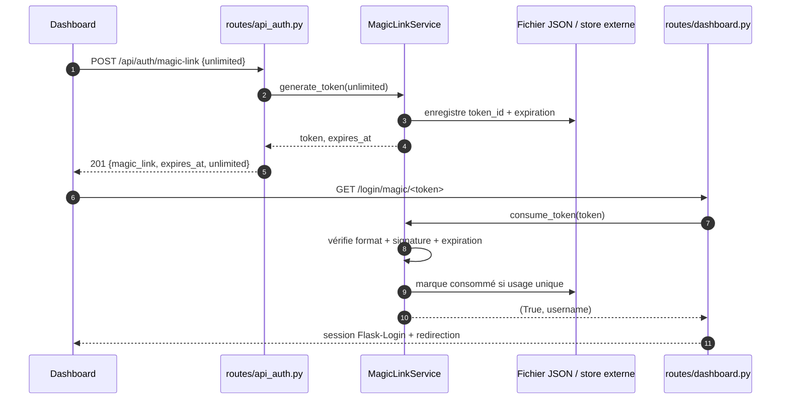

# Authentification

**TL;DR** : le dashboard accepte deux portes : le couple utilisateur/mot de passe (haché) et un magic link signé HMAC. Un lien à usage unique expire après 15 minutes par défaut ; un lien permanent reste réutilisable jusqu'à révocation. Les tokens sont stockés dans un fichier JSON verrouillé, avec un miroir optionnel vers Redis ou l'API PHP de configuration.

---

## Le problème : un mot de passe partagé et des sessions locales

Le dashboard était protégé par un mot de passe unique, souvent partagé entre plusieurs personnes. Deux conséquences :

- Impossible de révoquer l'accès d'une seule personne sans changer le mot de passe de tout le monde.
- Sur Render multi-conteneurs, chaque instance gardait sa propre session : une connexion réussie sur un worker pouvait être ignorée par le suivant.

Le magic link répond au premier point : un lien nominatif, à durée limitée, peut être révoqué ou simplement expiré. Le stockage partagé répond au second : tous les workers lisent le même état.

---

## La solution : deux portes, un même utilisateur Flask-Login

### ❌ L'ancien monde : comparaison en clair

```python
# ANTI-PATTERN
if password == settings.TRIGGER_PAGE_PASSWORD:
    login_user(User(username))
```

### ✅ Le nouveau monde : vérification hachée et token signé

```python
# routes/dashboard.py
if magic_token:
    success, message = _magic_link_service.consume_token(magic_token.strip())
    if success:
        return _complete_login(message, request.args.get("next"))
    error_message = message or "Token invalide."
else:
    user_obj = _auth_service.create_user_from_credentials(username, password)
    if user_obj is not None:
        return _complete_login(user_obj.id, request.args.get("next"))
```

`AuthService.create_user_from_credentials` délègue à `ConfigService.verify_dashboard_credentials`. La vérification accepte deux formats :

- mot de passe haché (Werkzeug, bcrypt ou scrypt) : `check_password_hash` ;
- mot de passe en clair historique : comparaison à temps constant avec `hmac.compare_digest`.

Le second format n'existe que pour la migration. Un mot de passe stocké en clair reste un risque : le hash est la cible.

La route `POST /login` accepte donc deux corps possibles :

| Champ | Effet |
| --- | --- |
| `username` + `password` | Vérification des identifiants du dashboard |
| `magic_token` | Consommation d'un magic link, puis ouverture de session |

Le formulaire HTML actuel n'expose que les champs utilisateur/mot de passe. Un magic token peut être soumis par POST direct ou consommé via l'URL `/login/magic/<token>`.

`POST /login` est limité à 5 tentatives par 5 minutes via `Flask-Limiter`.

---

## Anatomie d'un magic link

Un token a trois segments séparés par des points :

```
<token_id>.<expires>.<signature>
```

| Segment | Valeur | Rôle |
| --- | --- | --- |
| `token_id` | `secrets.token_urlsafe(16)` | Identifiant opaque du token |
| `expires` | timestamp Unix, ou `permanent` | Date d'expiration encodée |
| `signature` | HMAC-SHA-256 hexadécimal | Signature de `token_id.expires` avec `FLASK_SECRET_KEY` |

```python
# services/magic_link_service.py
token_id = secrets.token_urlsafe(16)
expires_component = "permanent" if unlimited else str(int(expires_at.timestamp()))
signature = self._sign_components(token_id, expires_component)
token = f"{token_id}.{expires_component}.{signature}"
```

La signature couvre l'identifiant **et** l'expiration : modifier l'un ou l'autre invalide le token. La comparaison utilise `hmac.compare_digest`, ce qui évite les fuites par timing.

### Cycle de vie



Un token inconnu, mal formé, expiré ou déjà consommé produit un message distinct (`Token inconnu ou déjà consommé.`, `Token expiré.`, `Signature de token invalide.`).

---

## Modes d'utilisation

| Mode | Durée | Réutilisable | Usage |
| --- | --- | --- | --- |
| Usage unique | `MAGIC_LINK_TTL_SECONDS` (900 s par défaut) | Non | Partage ponctuel, support, accès mobile |
| Permanent | Aucune expiration | Oui, jusqu'à révocation | Accès administrateur régulier |

```python
# Usage unique
token, expires_at = service.generate_token(unlimited=False)

# Permanent
token, expires_at = service.generate_token(unlimited=True)  # expires_at = None
```

Un token permanent reste un secret bearer : quiconque possède l'URL peut ouvrir une session. Il doit être traité comme un mot de passe, pas comme un lien public.

---

## API et routes

### Génération

```http
POST /api/auth/magic-link
Content-Type: application/json
Cookie: session=<session Flask-Login>

{"unlimited": false}
```

Réponse `201` :

```json
{
  "success": true,
  "magic_link": "https://<hôte>/login/magic/<token_id>.<expires>.<signature>",
  "expires_at": "2026-11-25T21:45:00+00:00",
  "unlimited": false
}
```

L'endpoint exige une session déjà authentifiée (`@login_required`). Un utilisateur anonyme ne peut pas générer de lien.

### Consommation

| Route | Méthode | Comportement |
| --- | --- | --- |
| `/login/magic/<token>` | GET | Valide le token, ouvre la session, redirige vers le dashboard |
| `/login` | POST | Accepte `magic_token` ou `username` + `password` |

En cas d'échec, la route de consommation redirige vers `/login` avec le message d'erreur en paramètre.

---

## Stockage : fichier verrouillé, miroir optionnel

`MagicLinkService` est un singleton configuré au démarrage avec `secret_key`, `storage_path`, `ttl_seconds`, `ConfigService` et un `external_store` optionnel.

### Fichier local

- Chemin : `MAGIC_LINK_TOKENS_FILE` (valeur par défaut dans `config/settings.py`).
- Écriture atomique : fichier temporaire puis `os.replace`.
- Verrou `RLock` en mémoire et verrou fichier pour les accès concurrents.
- Nettoyage des tokens expirés au chargement et après consommation.

### Miroir externe

Quand `REDIS_URL` est défini, ou quand `EXTERNAL_CONFIG_BASE_URL` et `CONFIG_API_TOKEN` sont définis, l'état est aussi écrit dans le config store partagé. La lecture privilégie ce store, puis retombe sur le fichier local.

```python
# services/magic_link_service.py
external_store_ok = self._save_state_to_external_store(serializable)
try:
    self._save_state_to_file(serializable)
except Exception:
    if not external_store_ok:
        raise
```

Conséquence pratique : le fichier reste la source de secours, mais un déploiement multi-workers doit avoir Redis ou l'API PHP pour partager les tokens en temps réel.

### Révocation

| Méthode | Effet |
| --- | --- |
| `revoke_token(token_id)` | Supprime un token précis |
| `revoke_all_tokens()` | Vide l'état local et le miroir externe |

Changer `FLASK_SECRET_KEY` invalide toutes les signatures d'un coup. C'est une révocation globale, mais elle déconnecte aussi les liens déjà distribués.

---

## Configuration

```bash
# Obligatoire
FLASK_SECRET_KEY=<chaîne longue et aléatoire>

# Durée de vie des liens à usage unique (secondes)
MAGIC_LINK_TTL_SECONDS=900

# Fichier local
MAGIC_LINK_TOKENS_FILE=./debug/magic_link_tokens.json

# Miroir Redis (optionnel)
REDIS_URL=redis://...

# Miroir API PHP (optionnel)
EXTERNAL_CONFIG_BASE_URL=https://votre-domaine.tld
CONFIG_API_TOKEN=<token partagé>
```

Un TTL inférieur à 60 secondes est ramené à 60 secondes par le service. Un `FLASK_SECRET_KEY` vide fait échouer l'initialisation.

---

## Intégration UI

### Dashboard

Le panneau Outils contient :

- `magicLinkUnlimitedToggle` : case « Mode illimité », préférence conservée dans `localStorage` ;
- `generateMagicLinkBtn` : déclenche la génération ;
- `magicLinkOutput` : affiche le lien et son expiration.

```javascript
// static/services/magic_link.js
const data = await ApiService.post('/api/auth/magic-link', { unlimited });
output.textContent = `${data.magic_link} (exp. ${expiresText})`;

try {
    await navigator.clipboard.writeText(data.magic_link);
    MessageHelper.showToast('Magic link copié dans le presse-papiers');
} catch {
    MessageHelper.showToast('Magic link généré — copie manuelle requise', 'info');
}
```

Le bouton passe par `MessageHelper.setButtonLoading` pour éviter les doubles clics, et le résultat est annoncé dans une zone `aria-live="polite"`.

### Login

`login.html` expose uniquement les champs `username` et `password`. La route `POST /login` accepte néanmoins un champ `magic_token`, et l'URL `/login/magic/<token>` consomme directement le lien. Il n'y a pas de champ « coller un magic link » dans l'interface actuelle : c'est une limite connue, pas un oubli de documentation.

---

## Sécurité : ce qui est couvert, ce qui ne l'est pas

| Risque | Protection |
| --- | --- |
| Falsification du token | Signature HMAC-SHA-256 sur `token_id.expires` |
| Comparaison timing | `hmac.compare_digest` |
| Mot de passe en clair | Fallback à temps constant, migration vers un hash recommandée |
| Rejeu d'un lien à usage unique | `consumed` marqué en stockage |
| Expiration | Timestamp signé, vérifié à chaque consommation |
| Force brute sur le login | `Flask-Limiter`, 5 tentatives / 5 minutes |
| Fuite dans les logs | `mask_sensitive_data` sur l'identifiant et l'utilisateur |

Limites assumées :

- Un magic link circule dans l'URL : il peut apparaître dans l'historique du navigateur, un proxy ou un journal d'accès. Le mode usage unique réduit la fenêtre d'exposition.
- Un lien permanent est un secret durable. Sa révocation est manuelle.
- Il n'y a pas de rotation automatique de `FLASK_SECRET_KEY`.

---

## Monitoring

Les événements sont journalisés avec le préfixe `MAGIC_LINK:` :

```text
MAGIC_LINK: token generated (expires_at=2026-11-25T21:45:00+00:00)
MAGIC_LINK: token <masqué> consommé par <utilisateur masqué>
MAGIC_LINK: token <masqué> invalidated (expired)
MAGIC_LINK: all tokens revoked
```

À surveiller :

- pics de génération de liens permanents ;
- taux élevé de `Signature de token invalide.` (clé changée ou tentative de falsification) ;
- croissance anormale du fichier de tokens (nettoyage en échec).

---

## Tests

Les tests du service vivent dans `tests/test_services.py` :

```bash
pytest tests/test_services.py -k magic_link -v
```

Trois scénarios couvrent le service :

- un token permanent reste réutilisable ;
- deux instances partagent l'état via un store externe ;
- l'ancienne signature d'initialisation du store externe reste acceptée.

Les routes `/api/auth/magic-link`, `/login/magic/<token>` et le formulaire de login ne disposent pas encore de tests dédiés. Toute modification de ces routes doit être vérifiée manuellement ou accompagnée d'un nouveau test.

---

## La Golden Rule : un lien est un mot de passe

Un magic link n'est pas un identifiant public, c'est un secret bearer. Signé, daté, à usage unique par défaut, stocké de façon partagée et révocable : chaque propriété doit rester vraie. Dès qu'un lien fuit, la seule réponse fiable est la révocation, pas l'espoir que personne ne le trouve.
